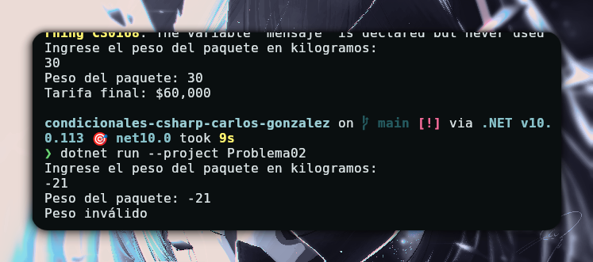

# Problema 02 - Tarifa de envío por peso

**Estructura elegida:** Elegí una estructura de switch expression,

**Justificación:** ya que me sirve para comprar valores entre rangos y definir una sola acción.

**Evidencia:**

