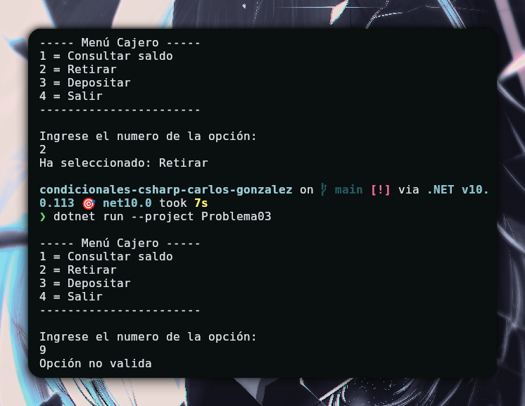

# Problema 03 - 

**Estructura elegida:** switch tradicional

**Justificación:** Los casos que les paso son datos exactos, no son rangos ni nada parecido, además no debo de asignar el resultado a una variable.

**Evidencia:**

