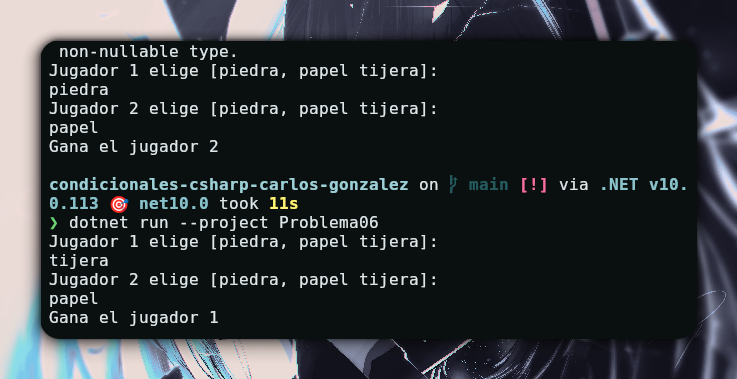

# Problema 06 - Piedra, papel o tijera

**Estructura elegida:** if else

**Justificación:** me resultó la forma más sencilla de comprar un resultado con otro para elegir un ganador

**Evidencia:**

