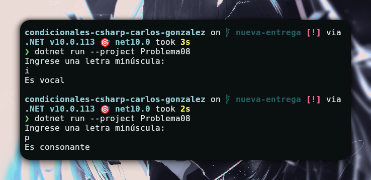

# Problema 08 - Vocal o consonante

**Estructura elegida:** switch expression

**Justificación:** Ofrece una gran utilidad para comparar grandes volumenes de letras sin escribirlas una a una

**Evidencia:**

