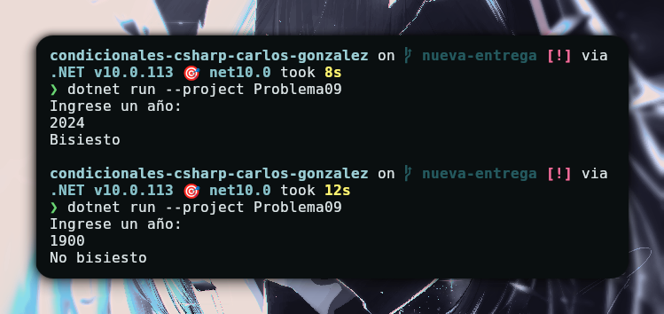

# Problema 09 - Año bisiesto

**Estructura elegida:** if else

**Justificación:** Por que se hace una estructura de comparación un poco más compleja y por que no tengo que guardar el dato que arroja en una variable.

**Evidencia:**

