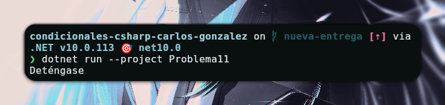

# Problema 11 - Semáforo inteligente

**Estructura elegida:** Switch

**Justificación:** Se utiliza un `switch` porque es la forma más clara y directa de evaluar una variable contra múltiples casos fijos.

**Evidencia:**

