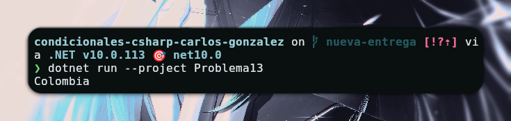

# Problema 13 - Códigos de país

**Estructura elegida:** Switch

**Justificación:** Se utiliza `switch` porque es ideal para comparar un valor (código de país) contra una lista de casos definidos.

**Evidencia:**

