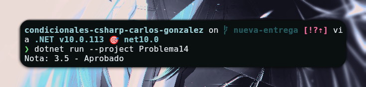

# Problema 14 - Estado del aprendiz

**Estructura elegida:** Operador Ternario

**Justificación:** Se utiliza el operador ternario ya que permite realizar la asignación condicional en una sola línea, cumpliendo con el requerimiento de simplicidad.

**Evidencia:**

