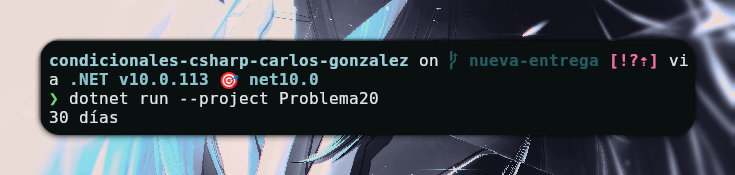

# Problema 20 - Días de cada mes

**Estructura elegida:** Switch

**Justificación:** Se utiliza `switch` con casos múltiples para agrupar los meses según la cantidad de días que poseen, lo cual hace el código limpio y eficiente.

**Evidencia:**

