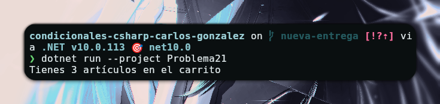

# Problema 21 - Carrito de compras

**Estructura elegida:** Operador Ternario

**Justificación:** Se utiliza el operador ternario para definir dinámicamente si la palabra debe estar en singular o plural dentro de la cadena de texto, permitiendo realizarlo en una sola línea de asignación.

**Evidencia:**

