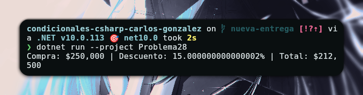

# Problema 28 - Descuento por compra

**Estructura elegida:** If - Else If y Operador Ternario

**Justificación:** Se utiliza `if-else if` para determinar el descuento base por valor y el operador ternario para calcular de forma sencilla el descuento adicional por ser cliente frecuente.

**Evidencia:**

