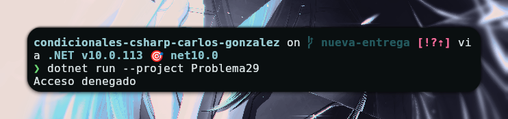

# Problema 29 - Control de acceso a la sede

**Estructura elegida:** Switch - If

**Justificación:** Se utiliza `switch` para evaluar el rol y determinar la lógica de acceso basada en la hora, y un `if` final para imprimir el resultado.

**Evidencia:**

